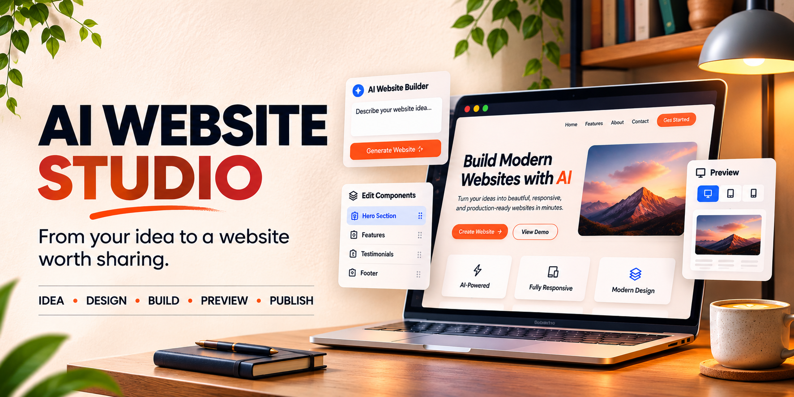
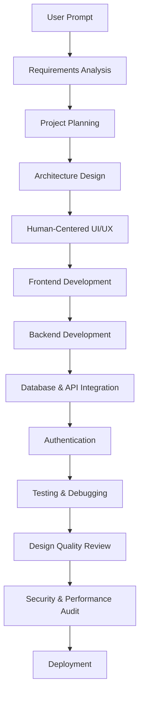

<div align="center">



<h1>AI Website Studio</h1>

**Professional end-to-end website and web application development through intelligent agent coordination**

[](#master-skill-architecture)
[](#internal-specialist-modules)
[](#claude-code-installation)
[](#opencode-installation)

[Quick Start](#quick-start) • [Architecture](#master-skill-architecture) • [Workflow](#website-development-workflow) • [Installation](#claude-code-installation) • [Documentation](#documentation-and-resources)

</div>

---

## About AI Website Studio

AI Website Studio delivers coherent, responsive, accessible websites and web applications from user briefs through coordinated specialist modules. Built for Claude Code and OpenCode environments, it preserves project conventions, uses verified integrations, and prioritizes human-centered design quality.

**Design Philosophy:** Avoid generic AI-generated interfaces through unique brand identity, professional typography, thoughtful visual hierarchy, meaningful color systems, purposeful interactions, and comprehensive UI states.

---

## Project Overview and Statistics

| Metric | Value |
|--------|-------|
| **Discoverable Skills** | 1 master skill |
| **Internal Modules** | 10 specialist references |
| **Human-Centered Modules** | 3 design quality systems |
| **Supported Workflows** | Requirements → Design → Development → Testing → Deployment |
| **Architecture** | Coordinated specialist playbook system |
| **Target Agents** | Claude Code, OpenCode |

---

## What Can You Build?

AI Website Studio handles complete web projects from concept to deployment:

- **Marketing Sites** — Landing pages, product showcases, portfolios
- **Web Applications** — Dashboards, SaaS platforms, admin panels
- **E-commerce** — Product catalogs, shopping carts, checkout flows
- **Content Platforms** — Blogs, documentation sites, knowledge bases
- **Interactive Tools** — Calculators, configurators, data visualizers
- **Authentication Systems** — User registration, login, role-based access
- **API Integrations** — Third-party services, webhooks, data synchronization
- **Full-Stack Projects** — Frontend + backend + database + deployment

---

## Master Skill Architecture

**Single Entry Point:** Users invoke only the master skill `ai-website-studio`. Internal specialist modules load automatically based on workflow requirements.

```text
User Prompt
    ↓
ai-website-studio (Master Skill)
    ↓
Loads relevant internal modules:
    • frontend-engineer
    • backend-engineer
    • fullstack-engineer
    • api-engineer
    • database-engineer
    • authentication-engineer
    • ui-ux-engineer
    • human-centered-product-design
    • design-quality-critic
    • product-experience-engineer
```

**Do not select individual modules manually.** The master skill coordinates the complete workflow.

---

## Internal Specialist Modules

| Module | Responsibility |
|--------|---------------|
| **frontend-engineer** | Component architecture, responsive layouts, client-side logic |
| **backend-engineer** | Server logic, API endpoints, business rules |
| **fullstack-engineer** | End-to-end feature implementation across stack layers |
| **api-engineer** | REST/GraphQL design, request validation, response formatting |
| **database-engineer** | Schema design, migrations, queries, indexing |
| **authentication-engineer** | User sessions, JWT, OAuth, role-based access control |
| **ui-ux-engineer** | Information architecture, interaction design, usability |
| **human-centered-product-design** | Brand identity, visual systems, design tokens |
| **design-quality-critic** | Visual hierarchy review, consistency audits |
| **product-experience-engineer** | Loading states, error handling, accessibility, polish |

All modules are internal reference playbooks loaded by the master skill as needed.

---

## Website Development Workflow



**Phased Execution:**

1. **Discovery** — Inspect existing project, conventions, dependencies
2. **Planning** — Map user journeys, data entities, acceptance criteria
3. **Design** — Create design tokens, component library, visual direction
4. **Implementation** — Build working vertical slices with complete UI states
5. **Integration** — Connect frontend, backend, database, authentication
6. **Validation** — Run builds, tests, accessibility checks, security reviews
7. **Refinement** — Address design quality critique findings
8. **Deployment** — Document setup, environment, deployment steps

---

## Human-Centered Product Design

AI Website Studio applies professional product quality standards throughout development:

### Design Principles

- **Unique Brand Identity** — Domain-appropriate visual language, not generic templates
- **Professional Typography** — Readable font scales, consistent text hierarchy
- **Thoughtful Visual Hierarchy** — Clear content organization, intentional focus
- **Consistent Spacing** — Systematic whitespace, predictable layout rhythm
- **Meaningful Color Systems** — Accessible contrast, purposeful color use
- **Purposeful Interactions** — Natural navigation, smooth transitions, feedback
- **Responsive Layouts** — Mobile-first approach, fluid breakpoints
- **Accessible Components** — ARIA labels, keyboard navigation, screen reader support
- **Complete UI States** — Loading, empty, error, success scenarios
- **Realistic Content** — Production-ready copy, images, data presentation

### Human-Centered Modules

**human-centered-product-design** — Establishes brand systems, design tokens, component foundations

**design-quality-critic** — Reviews implemented designs against professional standards

**product-experience-engineer** — Polishes interactions, states, accessibility, edge cases

These modules activate automatically for user-facing interfaces.

---

## Design Quality Review

Every user-facing interface passes through design quality gates:

| Review Dimension | Checks |
|-----------------|--------|
| **Visual Hierarchy** | Clear information structure, scannable content |
| **Consistency** | Design token adherence, component reuse |
| **Spacing** | Systematic margins, padding, gutters |
| **Typography** | Readable scales, appropriate weights, line heights |
| **Color** | Accessible contrast ratios, semantic color use |
| **Interactivity** | Hover states, focus indicators, transitions |
| **Responsiveness** | Mobile, tablet, desktop breakpoints |
| **Accessibility** | WCAG compliance, keyboard navigation, ARIA |
| **Loading States** | Skeletons, spinners, progress indicators |
| **Error Handling** | Validation messages, retry options, recovery |

Critique happens during development, not as final decoration pass.

---

## How the Master Skill Works

**Invocation Contract:**

```text
/ai-website-studio [your project requirements]
```

**Execution Flow:**

1. **Inspect** — Read repository structure, existing code, configurations
2. **Translate** — Convert brief into deliverables, assumptions, acceptance criteria
3. **Plan** — Build phased implementation plan with vertical slices
4. **Load** — Read relevant internal specialist references
5. **Discover** — Verify available tools, dependencies, APIs in environment
6. **Implement** — Build requested features preserving conventions
7. **Validate** — Run tests, builds, quality checks
8. **Report** — Document exact changes, results, unresolved issues

**Quality Gates:**

- Requirements map to implementation or documented non-goals
- Project builds/runs or blockers stated with evidence
- Tests cover critical flows
- Security, accessibility, performance considered
- Documentation matches delivered implementation
- No capability claimed complete without verified artifact

---

## Quick Start

### Project-Local Installation

Copy the master skill directory into your target project:

```bash
# Create skills directory if not exists
mkdir -p .claude/skills

# Copy AI Website Studio
cp -r /path/to/ai-website-studio/.claude/skills/ai-website-studio .claude/skills/
```

### Verify Installation

```bash
# Check skill structure
ls .claude/skills/ai-website-studio/
# Expected: SKILL.md, references/, scripts/, templates/, assets/
```

---

## Claude Code Installation

### Invoke the Master Skill

```text
/ai-website-studio
```

Or provide detailed requirements:

```text
/ai-website-studio Create a dashboard for project analytics with user authentication,
data visualization charts, and admin panel. Use React frontend, Node.js backend,
PostgreSQL database. Deploy on Vercel.
```

### Verify Skill Discovery

```text
/skills
```

Confirm `ai-website-studio` appears in available skills list.

---

## OpenCode Installation

### Invoke the Master Skill

```text
@ai-website-studio
```

Or with requirements:

```text
@ai-website-studio Build e-commerce site with product catalog, cart, checkout.
Stripe integration. Next.js + Tailwind CSS.
```

Agent discovery behavior varies by installed version and configuration.

---

## Technology Stack and Integrations

AI Website Studio works with existing project stacks or helps choose appropriate technologies:

### Frontend

- **Frameworks** — React, Vue, Angular, Svelte, Next.js, Nuxt
- **Styling** — Tailwind CSS, styled-components, CSS Modules, Sass
- **UI Libraries** — Material-UI, Ant Design, Chakra UI, shadcn/ui
- **State Management** — Redux, Zustand, MobX, Context API
- **Build Tools** — Vite, Webpack, Parcel, Turbopack

### Backend

- **Runtimes** — Node.js, Deno, Bun
- **Frameworks** — Express, Fastify, Koa, NestJS, Hono
- **APIs** — REST, GraphQL, tRPC, WebSockets
- **Authentication** — JWT, OAuth 2.0, Passport, Auth0, Clerk

### Database

- **SQL** — PostgreSQL, MySQL, SQLite
- **NoSQL** — MongoDB, Redis, DynamoDB
- **ORMs** — Prisma, Drizzle, TypeORM, Sequelize
- **Migrations** — Supported through project conventions

### Cloud & Deployment

- **Platforms** — Vercel, Netlify, Railway, Render, AWS, GCP
- **Containerization** — Docker, Docker Compose
- **CI/CD** — GitHub Actions, GitLab CI, CircleCI

**Note:** AI Website Studio provides implementation instructions. External services require user configuration and credentials.

---

## Backend and Database Configuration

### Database Setup

The master skill generates schema, migrations, and queries based on requirements:

```typescript
// Example: Prisma schema generation
model User {
  id        String   @id @default(cuid())
  email     String   @unique
  name      String?
  createdAt DateTime @default(now())
}
```

### API Endpoint Structure

```typescript
// Example: Express route implementation
app.post('/api/users', authenticate, validate(userSchema), async (req, res) => {
  // Validated, authenticated, error-handled
});
```

### Environment Variables

Document required configuration:

```bash
DATABASE_URL="postgresql://..."
JWT_SECRET="..."
API_KEY="..."
```

**Security:** Never commit secrets. Use `.env` files excluded from version control.

---

## Authentication and API Integration

### Supported Authentication Patterns

- **JWT** — Stateless token-based authentication
- **Session-based** — Server-side session management
- **OAuth 2.0** — Third-party provider integration
- **API Keys** — Service-to-service authentication
- **Role-based Access** — Permission systems, protected routes

### Third-Party Integrations

The skill generates integration code for:

- **Payment** — Stripe, PayPal
- **Email** — SendGrid, Resend, Nodemailer
- **Storage** — AWS S3, Cloudinary
- **Analytics** — Google Analytics, Plausible
- **Search** — Algolia, Elasticsearch

**Configuration Required:** API keys, webhooks, account setup by user.

---

## Testing and Quality Assurance

### Test Coverage

AI Website Studio implements tests for:

- **Unit Tests** — Component logic, utility functions
- **Integration Tests** — API endpoints, database operations
- **End-to-End Tests** — Critical user flows
- **Accessibility Tests** — WCAG compliance checks

### Testing Frameworks

Chosen based on project stack:

- **Frontend** — Vitest, Jest, React Testing Library
- **Backend** — Vitest, Jest, Supertest
- **E2E** — Playwright, Cypress

### Validation Commands

```bash
# Run tests
npm test

# Build verification
npm run build

# Linting
npm run lint

# Type checking
npm run typecheck
```

**Quality Standard:** Critical flows covered, builds pass, no blockers.

---

## Security and Performance

### Security Measures

- **Input Validation** — Schema-based request validation
- **SQL Injection Prevention** — Parameterized queries, ORM usage
- **XSS Protection** — Output sanitization, CSP headers
- **CSRF Protection** — Token validation on state-changing operations
- **Authentication** — Secure password hashing, token expiry
- **Authorization** — Role-based access control, permission checks
- **Secret Management** — Environment variables, no hardcoded credentials

### Performance Optimization

- **Code Splitting** — Lazy loading, dynamic imports
- **Image Optimization** — Responsive images, modern formats
- **Caching** — HTTP caching, CDN usage
- **Database Indexing** — Query optimization
- **Bundle Size** — Tree shaking, minification

---

## Deployment Guide

### Pre-Deployment Checklist

- [ ] All tests passing
- [ ] Build succeeds without errors
- [ ] Environment variables documented
- [ ] Database migrations ready
- [ ] Security review complete
- [ ] Performance benchmarks acceptable

### Platform-Specific Deployment

**Vercel (Next.js, React):**

```bash
vercel deploy
```

**Netlify (Static Sites):**

```bash
netlify deploy --prod
```

**Railway (Full-Stack):**

```bash
railway up
```

**Docker (Any Stack):**

```bash
docker build -t app .
docker run -p 3000:3000 app
```

**Manual Setup:**

AI Website Studio generates deployment documentation specific to chosen stack and platform.

---

## Output Structure and Deliverables

### File Structure

```text
project/
├── src/
│   ├── components/     # Reusable UI components
│   ├── pages/         # Route pages
│   ├── api/           # Backend endpoints
│   ├── lib/           # Utilities, helpers
│   ├── styles/        # Global styles, design tokens
│   └── types/         # TypeScript definitions
├── public/            # Static assets
├── tests/             # Test suites
├── prisma/            # Database schema (if applicable)
├── .env.example       # Environment template
├── package.json       # Dependencies
└── README.md          # Setup instructions
```

### Generated Artifacts

- **Source Code** — Complete, runnable implementation
- **Components** — Reusable, accessible UI elements
- **API Documentation** — Endpoint specs, request/response examples
- **Database Schema** — Migrations, seed data
- **Tests** — Unit, integration, E2E coverage
- **Setup Guide** — Installation, configuration, deployment steps
- **Environment Template** — Required variables documented

---

## Troubleshooting and FAQ

### Skill Not Discovered

**Check:** Skill location at `.claude/skills/ai-website-studio/SKILL.md`

**Verify:** Frontmatter contains `name: ai-website-studio`

**Restart:** Agent environment to refresh skill registry

### Build Failures

**Diagnose:** Read error output completely

**Verify:** Dependencies installed (`npm install`)

**Check:** Node version compatibility

**Review:** Environment variables set correctly

### Design Quality Issues

**Human-centered modules activate for user-facing interfaces.** If output seems generic:

- Specify brand requirements explicitly
- Reference design examples
- Request design quality review pass

### Authentication Not Working

**Verify:** Environment variables set (`JWT_SECRET`, etc.)

**Check:** Token expiry configuration

**Review:** CORS settings for API requests

### Database Connection Errors

**Check:** `DATABASE_URL` format

**Verify:** Database server running

**Test:** Connection string independently

### Deployment Failures

**Review:** Platform-specific requirements

**Check:** Build succeeds locally first

**Verify:** Environment variables set in platform

---

## Documentation and Resources

### Repository Structure

```text
ai-website-studio/
├── .claude/skills/ai-website-studio/
│   ├── SKILL.md                    # Master skill definition
│   └── references/                 # Internal specialist modules
│       ├── INDEX.md
│       ├── frontend-engineer.md
│       ├── backend-engineer.md
│       ├── fullstack-engineer.md
│       ├── api-engineer.md
│       ├── database-engineer.md
│       ├── authentication-engineer.md
│       ├── ui-ux-engineer.md
│       ├── human-centered-product-design.md
│       ├── design-quality-critic.md
│       └── product-experience-engineer.md
├── assets/                         # Banner, media
├── scripts/                        # Validation tools
├── AGENTS.md                       # Agent operating guide
├── skill-manifest.json             # Module registry
└── README.md                       # This documentation
```

### Validation

```bash
python scripts/validate_pack.py
```

Checks master skill, reference files, frontmatter, link integrity, secret detection.

### Contributing

**Keep master skill as sole discoverable entry point.** Add specialist knowledge as internal references. Update manifest when modules change.

### Module Updates

Edit reference files in `.claude/skills/ai-website-studio/references/`. Master skill loads them dynamically.

### Safety and Service Requirements

This repository contains agent instructions, reference playbooks, templates, helper scripts. **It is not:**

- A model or AI service
- An API subscription
- A cloud runtime
- A media generation engine
- A deployment service

**Capabilities depend on:** Tools, credentials, permissions, provider terms, quotas, dependencies, hardware configured in your environment.

**Never commit secrets.** Use `.env` files excluded from version control.

---

## License and Legal

**Copyright:** TheMamunZx

**Dependencies:** Respect licenses of frameworks, libraries, services used in generated projects.

**Media:** Use only assets with verified rights and compatible licenses.

**API Terms:** Comply with third-party service terms when integrating external APIs.

---

## Project Status

**Version:** 1.0.0  
**Status:** Active Development  
**Last Updated:** 2026-11-05  
**Maintainer:** TheMamunZx

---

<div align="center">

**Built for Claude Code and OpenCode**

[Report Issue](https://github.com/TheMamunZx/ai-website-studio/issues) • [Documentation](https://github.com/TheMamunZx/ai-website-studio) • [Universal Engineering Skills](https://github.com/TheMamunZx/universal-engineering-skills)

</div>
